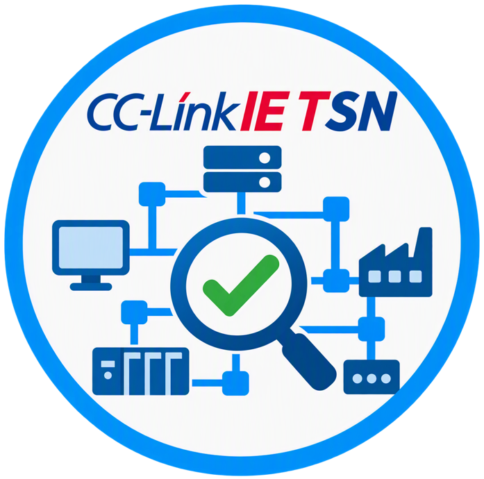

CC-Link IE TSN Structure Check Tool / CC-Link IE TSN構成チェックツール

## Introduction / イントロダクション

CC-Link IE TSN Structure Check Tool is a web application for visually creating and validating CC-Link IE TSN network configurations.
Users can place devices on a canvas, connect them, configure device parameters, and check the configuration against validation rules supported by this tool.

CC-Link IE TSN構成チェックツールは、CC-Link IE TSNのネットワーク構成を直感的に作成・検証できるWebアプリケーションです。
キャンバス上に機器を配置し、接続や機器パラメータを設定することで、本ツールが対応する検証ルールに基づいて構成を確認できます。

This tool is intended to support network design and validation work. Validation results are provided for reference and do not guarantee actual device behavior, system safety, or suitability for a specific use case.

本ツールは、ネットワーク設計および検証作業を支援するためのものです。検証結果は参考情報であり、実機での動作、システムの安全性、または特定用途への適合性を保証するものではありません。

## Getting Started / はじめに

You can use this tool to build a CC-Link IE TSN network configuration, edit device settings, and check the configuration against supported validation rules.

本ツールでは、CC-Link IE TSNのネットワーク構成を作成し、機器設定を編集し、本ツールが対応する検証ルールに基づいて構成を確認できます。

Key features / 主な特徴:

- Intuitive drag-and-drop editing / ドラッグ&ドロップによる直感的な構成図編集
- One-click configuration checking / ボタン一つで構成チェック
- Device settings on the diagram / 構成図上で機器設定を編集
- JSON-based save and load / 構成図をJSON形式で保存・読み込み

## Try the Tool / ツールを使う

<p align="center">
  <a href="https://mitsubishielectric.github.io/CCIETSN-Structure-Check-Tool/">
    
  </a>
  <br />
  <a href="https://mitsubishielectric.github.io/CCIETSN-Structure-Check-Tool/">Open the tool / ツールを開く</a>
</p>

## Prerequisites / 必要な環境

- Node.js 18 or later / Node.js 18以上
- npm
- Git

## Installation / インストール

Clone the repository and install dependencies.

リポジトリをクローンし、依存関係をインストールします。

```bash
git clone https://github.com/MitsubishiElectric/CCIETSN-Structure-Check-Tool.git
cd CCIETSN-Structure-Check-Tool
npm install
```

## Usage / 使い方

Start the local development server.

ローカル開発サーバーを起動します。

```bash
npm run dev
```

Open <http://localhost:5173> in your browser.

ブラウザで <http://localhost:5173> を開きます。

Basic workflow / 基本的な操作:

1. Create a network diagram / ネットワーク構成図を作成する
   - Drag and drop devices from the device list / 機器リストから機器をドラッグ&ドロップして配置する
   - Connect devices by dragging between nodes / ノード間をドラッグして接続する
2. Configure devices / 機器を設定する
   - Click a node to change station number, Class, speed, and other settings / ノードをクリックして局番、Class、速度などを変更する
   - Right-click a node to edit detailed parameters / ノードを右クリックして詳細パラメータを設定する
3. Validate the configuration / 構成を検証する
   - Click the structure check button / 構成チェックボタンをクリックする
   - Review the validation result and details if needed / 検証結果を確認し、必要に応じて詳細を確認する
4. Save or load data / データを保存・読み込みする
   - Export or import configurations as JSON / JSON形式で構成データをエクスポート・インポートする

For detailed usage, development procedures, data updates, and validation rules, see the documentation under `docs/`.

詳細な使い方、開発手順、データ更新、検証ルールについては、`docs/` 配下のドキュメントを参照してください。

## Contact Us / 問い合わせ

Please use GitHub Issues for bug reports, feature requests, and questions.
Do not include confidential information, private device data, or security-sensitive details in public issues.

バグ報告、機能要望、質問はGitHub Issuesを利用してください。
公開Issueには、機密情報、非公開の機器データ、セキュリティ上の詳細情報を記載しないでください。

## License / ライセンス

This project is licensed under the Apache License 2.0. See [`LICENSE`](./LICENSE) for details.

本プロジェクトはApache License 2.0の下でライセンスされています。詳細は [`LICENSE`](./LICENSE) を参照してください。

## Contributing / コントリビューション

Contributions are welcome. See [`CONTRIBUTING.md`](./CONTRIBUTING.md) for guidelines.

バグ修正、機能追加、ドキュメント改善などのコントリビューションを歓迎します。詳しくは [`CONTRIBUTING.md`](./CONTRIBUTING.md) を参照してください。

## Versioning / バージョニング

This project follows Semantic Versioning for public releases.
Release versions are published with GitHub Releases.

本プロジェクトの公開リリースでは、Semantic Versioningに従います。
リリースバージョンはGitHub Releasesで公開します。
